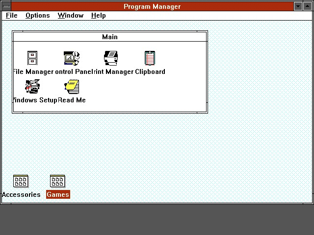
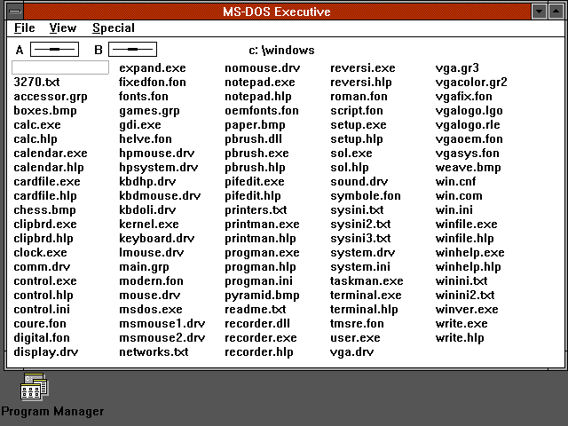
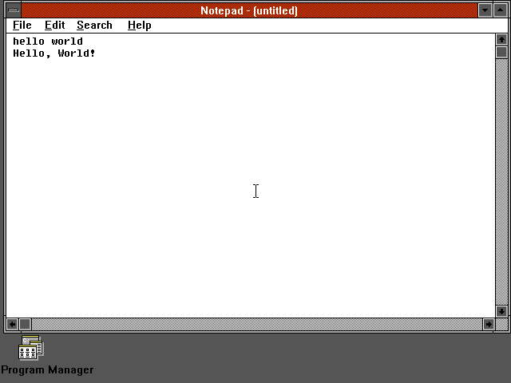
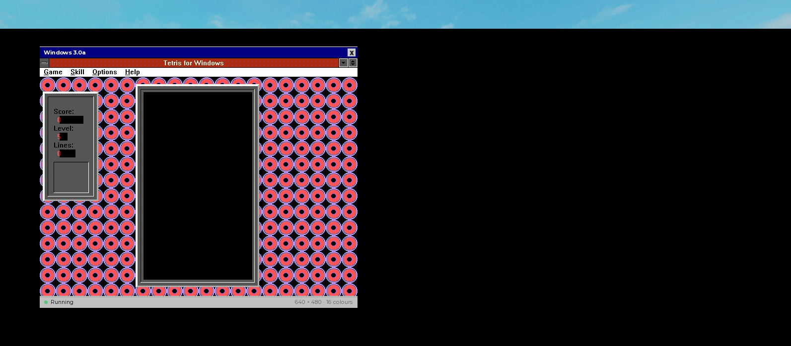
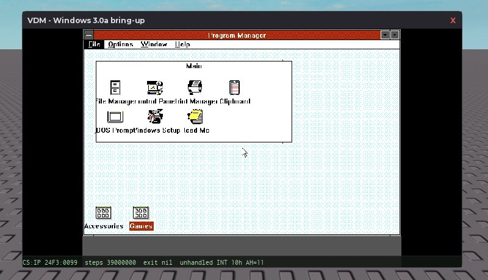

# RVDM — Windows 3.0a in a Roblox window

[](https://github.com/claykrs/Windows-3.x-VDM/actions/workflows/ci.yml)  

RVDM is an 8086 real-mode PC emulator written in Luau that boots the real
Microsoft Windows 3.0a binaries inside Roblox. `WIN.COM` loads `KERNEL.EXE`,
the drivers and fonts, then `GDI.EXE` and `USER.EXE`, and the real Program
Manager appears at 640×480 in an emulated VGA (mode 12h) framebuffer. Nothing
on screen is mocked: every window and pixel is the original 16-bit guest code
executing on the emulated CPU. The public repository is
<https://github.com/claykrs/Windows-3.x-VDM>.



## Verified state

- The real boot chain runs to the desktop: `WIN.COM` → `KERNEL.EXE` →
  drivers/fonts → `GDI.EXE` + `USER.EXE` → Program Manager, in a VGA mode-12h
  planar framebuffer.
- All 20 SETUP.INF applications launch and render: PROGMAN, WINFILE, WRITE,
  PBRUSH, NOTEPAD, CARDFILE, CALENDAR, CALC, CLOCK, REVERSI, CONTROL, TASKMAN,
  WINVER, CLIPBRD, PIFEDIT, RECORDER, PRINTMAN, SOL, TERMINAL, MSDOS.
  Per-app matrix and NE header facts: [docs/APP_COMPAT.md](docs/APP_COMPAT.md).
- Microsoft Tetris 2.0 (Windows Entertainment Package: `TETRIS.EXE`,
  `ABOUTTET.DLL`, `WIN87EM.DLL`) runs, including live in Roblox Studio.
- Input is emulated hardware, not LED fakes: an 8042 keyboard (set-1 make/break
  scan codes, typematic repeat) and a PS/2 mouse (IRQ12/C207, half-count
  2 px-per-count contract with re-anchoring plus a measured +58 px Y-bias
  compensation). Verified: Alt+F menus, Notepad typing, Calculator keypad, and
  a fully synthetic mouse click dismissing Tetris' About dialog in a live
  Studio boot.
- PC speaker: the 8254 channel-2 divisor (ports 0x43/0x42) and the port 0x61
  gate are modelled; the host replays an optional short beep on state changes.
- The gate `lune run tools/check.lua` passes: stylua, selene (luau + roblox),
  `luau-analyze --mode=strict`, and 924 test assertions.







## Architecture

`core/` is environment-pure `--!strict` Luau: no `game`, no filesystem, no
`print`. Dependencies are injected through `Machine.new(deps)` and diagnostics
go through `machine:log()`, so the same core runs under Lune (tools, tests)
and inside Roblox (client-side only — the server has no role in emulation).

| Path | Contents |
| --- | --- |
| `core/` | `Memory`, `Cpu`, `Vfs`, `Bios`, `Dos`, `Xms`, `TextScreen`, `Executables`, `Vga`, `Machine` |
| `roblox/client/` | `Emulator.client.lua` (frame loop, keyboard, pointer), `VgaSink.lua`, `ScreenSink.lua`, `KeyboardMap.lua` |
| `roblox/ui/` | `Theme`, `Cleaner`, `Window`, `Components`, `State` — the Windows 3.0-style host window |
| `fixtures/` | NE4 test fixture, `Kernel16`, generated `WinBoot*.lua` boot bundles (git-ignored) |
| `tests/` | `CpuTests`, `PmCpuTests`, `XmsTests`, `MachineTests`, `DosTests`, `GroupFileTests` |
| `tools/` | `extract`, `stage`, `pack_winboot`, `build_rbxmx`, `install`, `app_harness`, `check` |
| `docs/` | `APP_COMPAT.md`, `PHOTOSHOP.md`, `R7-PLAN.md`, `R7-CALLBACK.md`, `screenshots/` |

Machine internals:

- **CPU** — 8086 instruction set plus a 286 subset (protected-mode segment
  caches, call gates, VERR/VERW, LIDT/LMSW), `bit32`-only: Luau has no native
  bitwise operators.
- **DOS** — INT 21h subset with an MCB arena, SFT and list-of-lists; COM, MZ
  (with relocations) and NE (segments, fixups, entry tables) loaders, plus
  bound MZ+NE images such as `KERNEL.EXE`.
- **Devices** — PIT timer (IRQ0), PS/2 keyboard (IRQ1) and mouse (IRQ12), and
  a VGA planar renderer with dirty rectangles.
- **Host presentation** — a themed Windows 3.0-style host window whose content
  is the VGA framebuffer: an `EditableImage` sink updated per dirty rectangle,
  falling back to a coarse 32-column Frame grid when Mesh/Image APIs are off.
  Keyboard input enters through an 8042 port model as set-1 scan codes. The
  framebuffer is authoritative; a native ScreenGui mapping was prototyped and
  rejected because USER/GDI owner-draw, bitmap fonts and BitBlt cannot be
  reproduced without reimplementing the GUI (see `roblox/gui/FEASIBILITY.md`).

## Running it

### Harness (Lune)

Lune 0.11.1 ships in `tools/bin/`. The harness boots the real media and
reports exactly where the boot stopped; screenshots land in `tools/out/`
(git-ignored).

```powershell
tools\bin\lune.exe run tools/app_harness.lua boot CALC --timer 55000
tools\bin\lune.exe run tools/app_harness.lua boot all --via ini --steps 5000000 --timer 55000
tools\bin\lune.exe run tools/app_harness.lua list     # NE header facts
tools\bin\lune.exe run tools/app_harness.lua audit    # SETUP.INF staging coverage
```

Always pass `--timer 55000` for guest code. The default 25,000 fires IRQ0
fast enough to trip KERNEL's critical-section guard (`fatal 0x140`); 25k runs
are diagnostic only.

### Studio

Build the model (or take `Vdm.rbxmx` from the
[releases page](https://github.com/claykrs/Windows-3.x-VDM/releases)):

```powershell
tools\bin\lune.exe run tools/build_rbxmx.lua   # writes Vdm.rbxmx
```

1. Import `Vdm.rbxmx` — it installs `Vdm`, `VdmUi` and `VdmFixtures` into
   `ReplicatedStorage` and the client scripts into `StarterPlayerScripts`.
2. Enable **Game Settings → Security → Allow Mesh / Image APIs**. Without it
   `EditableImage` creation fails and `VgaSink` falls back to its 32-column
   Frame grid.
3. Set the `ReplicatedStorage` attribute `VdmBootWindows` to `true`. Without
   the attribute the client shows the bundled NE4 test fixture instead of
   Windows.



## Media pipeline and licensing

The Microsoft binaries are not in the repository. Either unzip
`win30a-media.zip` from the [releases page](https://github.com/claykrs/Windows-3.x-VDM/releases)
into `media/win30/`, or place your own Windows 3.0a 5.25-inch 1.2 MB `.IMG`
set (e.g. the WinWorld images) in `media/win30/Microsoft Windows 3.0a (5.25 1.2MB)/`.
Then:

```powershell
tools\bin\lune.exe run tools/extract.lua        # FAT12 floppies -> media/win30/files/
tools\bin\lune.exe run tools/stage.lua          # SZDD decompress -> media/win30/staged/
tools\bin\lune.exe run tools/pack_winboot.lua   # -> fixtures/WinBoot*.lua (git-ignored)
```

`extract.lua` walks the FAT12 floppy images, `stage.lua` decompresses
Microsoft SZDD-compressed files, and `pack_winboot.lua` packs `WIN.COM`,
KERNEL, the drivers/fonts, every built-in executable and the generated
program groups into the `fixtures/WinBoot*.lua` modules the Studio client
loads. Those generated fixtures contain Microsoft binaries and stay out of
git.

The emulator source is MIT-licensed. The Microsoft Windows media remains the
property of Microsoft; supply your own copy to run it.

## Testing

`tools/check.lua` runs the same gates CI runs
([.github/workflows/ci.yml](.github/workflows/ci.yml)): a stylua format
check, selene lint over core/tools/tests plus a Roblox-config pass,
`luau-analyze --mode=strict` over `core/`, and the test suite — currently
924 assertions.

```powershell
tools\bin\lune.exe run tools/check.lua
```

Application compatibility is verified with the harness and documented in
[docs/APP_COMPAT.md](docs/APP_COMPAT.md).

## Known limits

- **640 K real-mode wall.** Conventional memory only; no demand segment
  loading yet.
- **No EMS, and no XMS on the 3.0a path.** INT 67h reports EMM as not
  installed; XMS exists in the core but is only enabled on the 286 track.
- **No DOS `COMMAND.COM`.** It is a DOS file, not part of the Windows media,
  so the Main group's DOS Prompt item reports "Cannot find file" by design.
- **Instruction-counted timer.** IRQ0 fires every `config.timerInterval`
  instructions, not on wall-clock PIT timing.
- **Cosmetics.** Some icon planes show colour artifacts, Program Manager packs
  group labels too tightly at 640×480, and Tetris' score/level/lines digits
  draw beside their opaque value backgrounds. Gameplay is unaffected.
- **Missing subsystems.** No printer (LPT/INT 17h/spooler), serial (8250/INT
  14h) or OLE/clipboard backends; installers run from the staged VFS only.

## In progress: Windows 3.1 standard mode

The 286 protected-mode track (real `DOSX.EXE` + `KRNL286.EXE`) is actively
being finished. Where it stands:

- **Done:** the PM core (GDT/LDT/IDT/TSS, expand-down data segments, ring
  transitions, PM↔RM switching with full state save/restore), the XMS driver
  (top-first allocation), and the boot chain — `WIN.COM` EXECs WSWAP and
  DOSX cleanly, DOSX claims extended memory, relocates its PM image, and
  KRNL286 executes in protected mode.
- **Just fixed (R9):** the kernel's first protected-mode fault — a `#GP`
  in the GlobalAlloc heap walk at step ~144k — is root-caused and solved
  (`6557b2e`). Our CPU's `LAR`/`LSL` inverted the ZF semantics, so
  KRNL286's selector-validation path (`lar ax,sel / jne`) mis-resolved
  seg1's home block and a 0xB6CB-byte move wiped the kernel heap header.
  With Intel-correct flags the boot now loads KRNL286's segments fault-free
  through step ~162k.
- **Being finished now (R10):** after KRNL286 initialization the boot
  returns to real mode at `0x0C9B` and wild-far-returns into the BIOS area
  (`FFFF:10FD`). Tracing the callback/dispatch path that real DOSX uses
  there is the current frontier; after it, the kernel continues toward
  USER/GDI 3.1.

Planning and callback research: [docs/R7-PLAN.md](docs/R7-PLAN.md),
[docs/R7-CALLBACK.md](docs/R7-CALLBACK.md). This is the track Photoshop 2.5
targets ([docs/PHOTOSHOP.md](docs/PHOTOSHOP.md)).

Planning and callback research: [docs/R7-PLAN.md](docs/R7-PLAN.md),
[docs/R7-CALLBACK.md](docs/R7-CALLBACK.md). This is the track Photoshop 2.5
targets ([docs/PHOTOSHOP.md](docs/PHOTOSHOP.md)).

## Roadmap

- **Windows 3.0a real mode:** EMS, demand segment loading, printer/serial
  backends and the remaining cosmetic fixes.
- **Windows 3.1 standard mode (286 protected mode):** in-progress R&D on the
  DOSX/KRNL286 bring-up. It does not boot yet; see
  [docs/R7-PLAN.md](docs/R7-PLAN.md) and
  [docs/R7-CALLBACK.md](docs/R7-CALLBACK.md). This is the track Photoshop 2.5
  targets ([docs/PHOTOSHOP.md](docs/PHOTOSHOP.md)).
- **386 enhanced mode** (paging/V86/VxD) is a later track for the wider 3.1
  software library.
