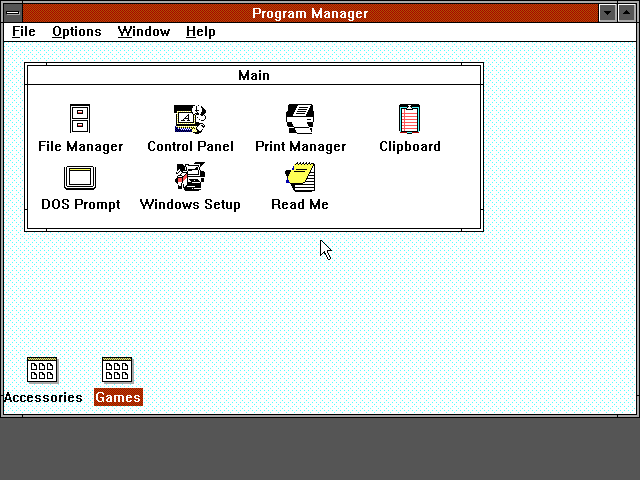
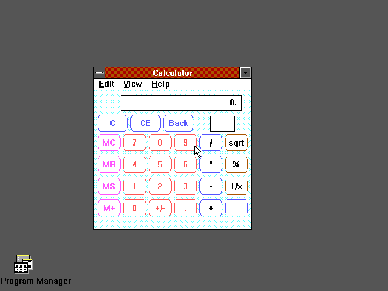
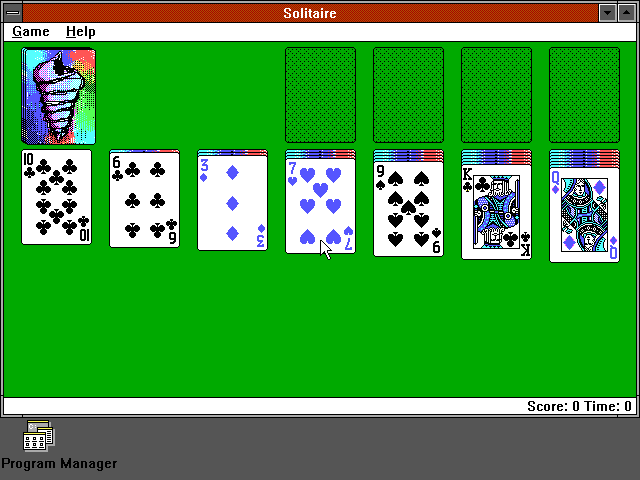
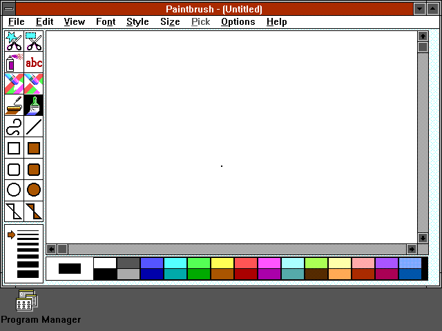
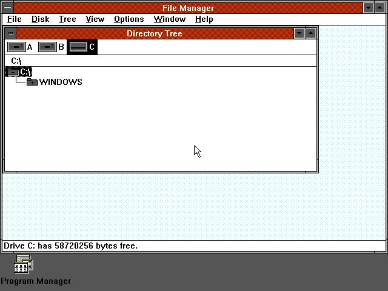
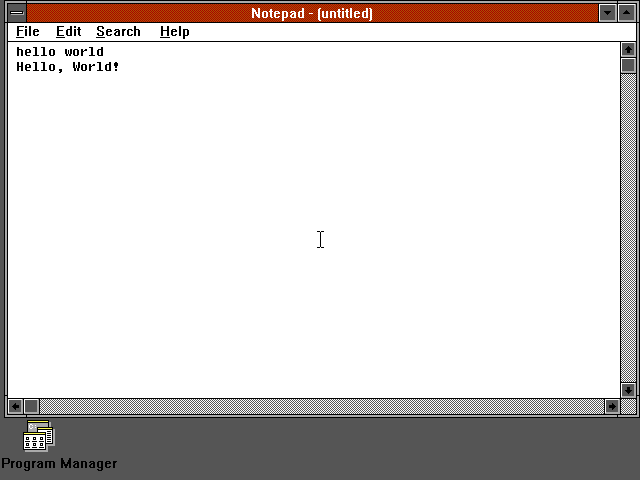
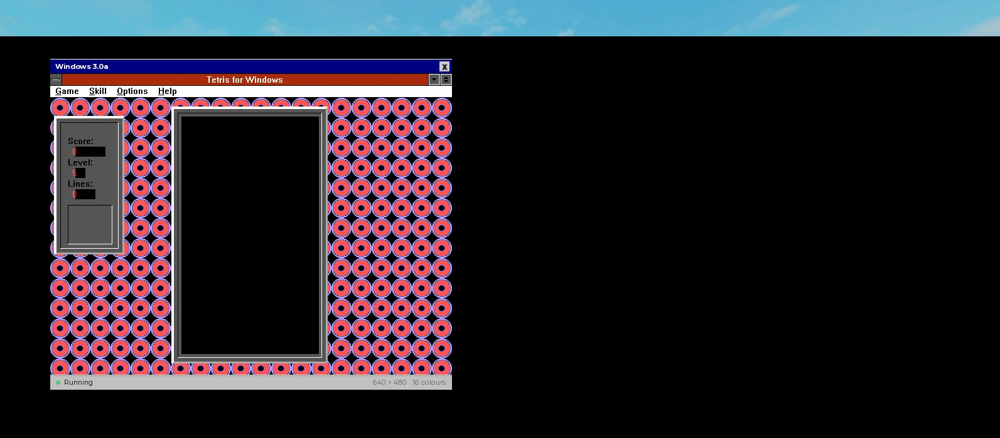
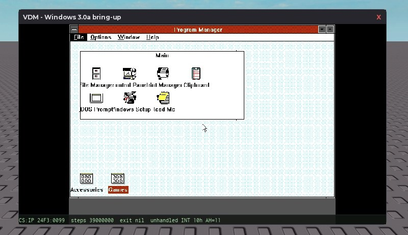

# roblox-win3-emulator — Windows 3.0a running inside Roblox

[](https://github.com/claykrs/roblox-win3-emulator/actions/workflows/ci.yml)  

RVDM is an 8086 real-mode PC emulator written in Luau that boots the real
Microsoft Windows 3.0a binaries inside Roblox. `WIN.COM` loads `KERNEL.EXE`,
the drivers and fonts, then `GDI.EXE` and `USER.EXE`, and the real Program
Manager appears at 640×480 in an emulated VGA (mode 12h) framebuffer. Nothing
on screen is mocked: every window and pixel is the original 16-bit guest code
executing on the emulated CPU.



| | |
| --- | --- |
|  |  |
| *Calculator* | *Solitaire* |
|  |  |
| *Paintbrush* | *File Manager* |

Every screenshot is the real Windows 3.0a code running on the emulated CPU and
VGA; nothing on screen is drawn by the host.

## Verified state

- The real boot chain runs to the desktop: `WIN.COM` → `KERNEL.EXE` →
  drivers/fonts → `GDI.EXE` + `USER.EXE` → Program Manager, in a VGA mode-12h
  planar framebuffer.
- All 20 SETUP.INF applications launch and render: PROGMAN, WINFILE, WRITE,
  PBRUSH, NOTEPAD, CARDFILE, CALENDAR, CALC, CLOCK, REVERSI, CONTROL, TASKMAN,
  WINVER, CLIPBRD, PIFEDIT, RECORDER, PRINTMAN, SOL, TERMINAL, MSDOS.
  Per-app matrix and NE header facts: [docs/APP_COMPAT.md](docs/APP_COMPAT.md).
- Microsoft Tetris 2.0 (Windows Entertainment Package: `TETRIS.EXE`,
  `ABOUTTET.DLL`, `WIN87EM.DLL`) runs, including live in Roblox Studio.
- Input goes through emulated hardware: an 8042 keyboard (set-1 scan codes,
  typematic repeat) and a PS/2 mouse. Menus, typing in Notepad, the
  Calculator keypad and mouse clicks all work in a live Studio boot.
- PC speaker: the 8254 channel-2 divisor (ports 0x43/0x42) and the port 0x61
  gate are modelled; the host replays an optional short beep on state changes.
- MS-DOS Prompt runs: the Main group item launches `WINOLDAP`, the grabber and
  a stand-in `COMMAND.COM` as a full-screen text session; `exit` returns to
  Program Manager. The host maps hardware scan codes to the DOS key buffer
  while the DOS child runs.
- The gate `lune run tools/check.lua` passes: stylua, selene (luau + roblox),
  `luau-analyze --mode=strict`, and 1015 test assertions.

| | |
| --- | --- |
|  |  |
| *Typing in Notepad through the emulated keyboard* | *Microsoft Tetris 2.0* |

## Architecture

`core/` is environment-pure `--!strict` Luau: no `game`, no filesystem, no
`print`. Dependencies are injected through `Machine.new(deps)` and diagnostics
go through `machine:log()`, so the same core runs under Lune (tools, tests)
and inside Roblox (client-side only — the server has no role in emulation).

| Path | Contents |
| --- | --- |
| `core/` | `Memory`, `Cpu`, `Vfs`, `Bios`, `Dos`, `Xms`, `TextScreen`, `Executables`, `Vga`, `Machine` |
| `roblox/client/` | `Emulator.client.lua` (frame loop, keyboard, pointer), `VgaSink.lua`, `ScreenSink.lua`, `KeyboardMap.lua` |
| `roblox/ui/` | `Theme`, `Cleaner`, `Window`, `Components`, `State` — the Windows 3.0-style host window |
| `fixtures/` | NE4 test fixture, `Kernel16`, generated `WinBoot*.lua` boot bundles (git-ignored) |
| `tests/` | `CpuTests`, `PmCpuTests`, `XmsTests`, `MachineTests`, `DosTests`, `GroupFileTests` |
| `tools/` | `extract`, `stage`, `pack_winboot`, `build_rbxmx`, `install`, `app_harness`, `check` |
| `docs/` | `APP_COMPAT.md`, `ENGINEERING-LOG.md`, `STYLE.md`, `screenshots/` |

Machine internals:

- **CPU** — 8086 instruction set plus a 286 subset (protected-mode segment
  caches, call gates, VERR/VERW, LIDT/LMSW), `bit32`-only: Luau has no native
  bitwise operators.
- **DOS** — INT 21h subset with an MCB arena, SFT and list-of-lists; COM, MZ
  (with relocations) and NE (segments, fixups, entry tables) loaders, plus
  bound MZ+NE images such as `KERNEL.EXE`.
- **Devices** — PIT timer (IRQ0), PS/2 keyboard (IRQ1) and mouse (IRQ12), and
  a VGA planar renderer with dirty rectangles.
- **Host presentation** — a themed Windows 3.0-style host window whose content
  is the VGA framebuffer: an `EditableImage` sink updated per dirty rectangle,
  falling back to a coarse 32-column Frame grid when Mesh/Image APIs are off.
  Keyboard input enters through an 8042 port model as set-1 scan codes. The
  framebuffer is authoritative: a native ScreenGui mapping was prototyped and
  rejected, because USER/GDI owner-draw, bitmap fonts and BitBlt cannot be
  reproduced without reimplementing the GUI.

## Running it

### Harness (Lune)

Install the pinned tools (Lune 0.11.1, selene, StyLua, luau) with
[Rokit](https://github.com/rojo-rbx/rokit): run `rokit install` in the repo.
The harness boots the real media and reports exactly where the boot stopped;
screenshots land in `tools/out/` (git-ignored).

```powershell
lune run tools/app_harness.lua boot CALC --timer 55000
lune run tools/app_harness.lua boot all --via ini --steps 5000000 --timer 55000
lune run tools/app_harness.lua list     # NE header facts
lune run tools/app_harness.lua audit    # SETUP.INF staging coverage
```

Always pass `--timer 55000` for guest code. The default 25,000 fires IRQ0
fast enough to trip KERNEL's critical-section guard (`fatal 0x140`); 25k runs
are diagnostic only.

### Studio

The model from the [releases page](https://github.com/claykrs/roblox-win3-emulator/releases)
holds the whole emulator and its Studio window, but no Microsoft files, so on
its own it boots the bundled test program. To boot Windows, pack your own
Windows 3.0a disks first ([Media pipeline](#media-pipeline-and-licensing)),
then build the model, which picks up the packed `fixtures/WinBoot*.lua`:

```powershell
lune run tools/build_rbxmx.lua   # writes Vdm.rbxmx
```

1. Import `Vdm.rbxmx` — it installs `Vdm`, `VdmUi` and `VdmFixtures` into
   `ReplicatedStorage` and the client scripts into `StarterPlayerScripts`.
2. Enable **Game Settings → Security → Allow Mesh / Image APIs**. Without it
   `EditableImage` creation fails and `VgaSink` falls back to its 32-column
   Frame grid.
3. Set the `ReplicatedStorage` attribute `VdmBootWindows` to `true` and press
   Play. Without the attribute the client shows the bundled NE4 test fixture
   instead of Windows.



## Media pipeline and licensing

The Microsoft binaries are not in the repository and are not distributed with
releases. Supply your own Windows 3.0a 5.25-inch 1.2 MB `.IMG` set in
`media/win30/Microsoft Windows 3.0a (5.25 1.2MB)/`. Then:

```powershell
lune run tools/extract.lua        # FAT12 floppies -> media/win30/files/
lune run tools/stage.lua          # SZDD decompress -> media/win30/staged/
lune run tools/pack_winboot.lua   # -> fixtures/WinBoot*.lua (git-ignored)
```

`extract.lua` walks the FAT12 floppy images, `stage.lua` decompresses
Microsoft SZDD-compressed files, and `pack_winboot.lua` packs `WIN.COM`,
KERNEL, the drivers/fonts, every built-in executable and the generated
program groups into the `fixtures/WinBoot*.lua` modules the Studio client
loads. Those generated fixtures contain Microsoft binaries and stay out of
git.

The emulator source is MIT-licensed. The Microsoft Windows media remains the
property of Microsoft; supply your own copy to run it.

## Testing

`tools/check.lua` runs the same gates CI runs
([.github/workflows/ci.yml](.github/workflows/ci.yml)): a stylua format
check, selene lint over core/tools/tests plus a Roblox-config pass,
`luau-analyze --mode=strict` over `core/`, and the test suite — currently
1015 assertions.

```powershell
lune run tools/check.lua
```

Application compatibility is verified with the harness and documented in
[docs/APP_COMPAT.md](docs/APP_COMPAT.md).

## Known limits

- **640 K real-mode wall.** Conventional memory only; no demand segment
  loading yet.
- **No EMS, and no XMS on the 3.0a path.** INT 67h reports EMM as not
  installed; XMS exists in the core but is only enabled on the 286 track.
- **Stand-in `COMMAND.COM`.** Microsoft's is not part of the Windows media, so
  the Main group's DOS Prompt item runs a 254-byte stand-in
  (`fixtures/Command.lua`): banner, `C:\>` prompt, `exit` returns to Windows,
  anything else answers "Bad command or file name". It is not a real shell.
- **Instruction-counted timer.** IRQ0 fires every `config.timerInterval`
  instructions, not on wall-clock PIT timing.
- **Cosmetics.** Some icon planes show colour artifacts and Tetris'
  score/level/lines digits draw beside their opaque value backgrounds.
  Gameplay is unaffected.
- **Missing subsystems.** No printer (LPT/INT 17h/spooler), serial (8250/INT
  14h) or OLE/clipboard backends; installers run from the staged VFS only.

## In progress: Windows 3.1 standard mode

The 286 protected-mode track runs the real `DOSX.EXE` and `KRNL286.EXE`:

- The protected-mode core (GDT/LDT/IDT/TSS, expand-down segments, ring
  transitions, real↔protected mode switching) and the XMS driver are done.
- The boot reaches a drawn Program Manager in standard mode and the apps load.
- MS-DOS Prompt launches through WSWAP/DSWAP and returns on `exit`.
- Open: Windows can fault when it resumes after a swap-in. Details are in the
  [engineering log](docs/ENGINEERING-LOG.md).

## Roadmap

- **Windows 3.0a real mode:** EMS, demand segment loading, printer/serial
  backends and the remaining cosmetic fixes.
- **Windows 3.1 standard mode (286 protected mode):** boots to Program
  Manager; MS-DOS Prompt resume is the open item.
- **386 enhanced mode** (paging/V86/VxD) is a later track for the wider 3.1
  software library.
