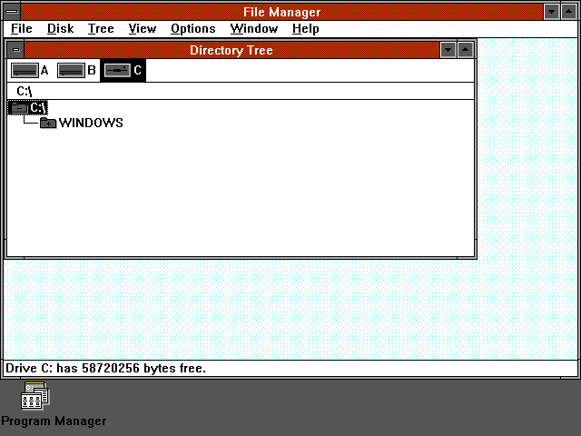
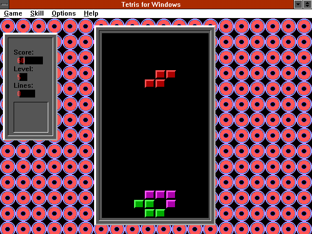

# RVDM — Windows 3.0a in a Roblox window

A passion project: an **8086 real-mode PC** written in Luau, running the real
Windows 3.0a boot chain inside Roblox. Microsoft's `WIN.COM` loads KERNEL,
the drivers and fonts, then GDI and USER, and the real Program Manager appears
in an emulated VGA framebuffer. The guest is the original 16-bit code; there
are no mocked screens or hardcoded app output.







## What works

| Area | Status |
| --- | --- |
| 8086 CPU | Full real-mode instruction set, `bit32`-only, strict-typed |
| BIOS | INT 10h text/graphics, INT 16h keyboard, INT 9/IRQ1, timer IRQ0 |
| DOS | INT 21h console, handles, files, EXEC, memory; PSP, MCB arena, SFT/list-of-lists |
| Loaders | COM, MZ with relocations, NE segments/fixups/entry tables, bound MZ+NE |
| Windows 3.0a | Real `WIN.COM` → KERNEL → drivers/fonts → GDI/USER → Program Manager |
| Applications | 20/20 SETUP.INF apps, plus third-party Win16 EXEs such as Microsoft Tetris 2.0 |
| Input | 8042 keyboard with typematic repeat; 1:1 PS/2 mouse with click-time anchoring; Alt+F menus and Calculator keypad |
| Display | VGA mode 12h/13h planar framebuffer rendered through an `EditableImage`, with dirty-rectangle uploads |
| Sound | PC speaker: guest PIT channel 2 divisor + port 0x61 gate, with an optional short Roblox beep |
| Tests | 477 assertions, plus formatting, lint and strict typecheck |

## Build it

Windows 3.0a media is supplied on the release page as `win30a-media.zip`.
Unzip it into `media/win30/`, then run the commands below. The source repo
still keeps the Microsoft binaries out of git; the packaged release (model,
demo place, media zip) is the convenient path.


```powershell
# Your own media in media/win30/
lune run tools/extract.lua
lune run tools/stage.lua

# Generate the boot fixtures and the importable model
lune run tools/pack_winboot.lua
lune run tools/build_rbxmx.lua   # writes Vdm.rbxmx
```

Import `Vdm.rbxmx` into Roblox Studio, enable **Game Settings → Security →
Allow Mesh / Image APIs**, and set the `ReplicatedStorage` attribute
`VdmBootWindows` to `true`. Without the attribute the client shows the bundled
NE4 fixture instead of Windows.

The generated boot modules and `Vdm.rbxmx` are git-ignored: they contain
Microsoft binaries and must not be committed.

## Notes

- The emulator lives in `core/` and never touches `game`, the filesystem or
  `print`; dependencies are injected through `Machine.new(deps)`.
- Roblox work is entirely client-side. The VGA framebuffer is authoritative;
  a native ScreenGui mapping was prototyped and rejected because USER/GDI
  owner-draw, bitmap fonts and BitBlt cannot be reproduced without
  reimplementing the GUI.
- The DOS Prompt group item still needs a real `COMMAND.COM`; it is a DOS
  interpreter, not part of the Windows media. The other Main-group items and
  all 20 SETUP.INF applications launch.

## Roadmap

- **R5 (current):** real Program Manager with generated groups, all 20
  SETUP.INF applications, keyboard and mouse input. Remaining polish: icon
  colour artifacts and group-label spacing.
- **R6 (current, real mode):** third-party Windows 3.0 compatibility. Tetris
  2.0 is playable: menus, level screen, falling and stacked pieces, keyboard
  control and a single host/guest mouse cursor. The score/level/lines digits
  draw in red at the left of their opaque backgrounds (the backgrounds sit one
  character cell to the right; still cosmetic). PC speaker output is wired to
  PIT channel 2 and port 0x61. Next: fix those value backgrounds, EMS/XMS,
  Sound Blaster and scratch-disk support.
- **R7 (next track):** 286 protected mode and Windows 3.1 Standard mode, then
  386 enhanced mode (paging/V86/VxD) for the wider 3.1 software library.

## License

MIT for the emulator source. Microsoft Windows media is not included and
remains the property of Microsoft; supply your own copy to run it.
